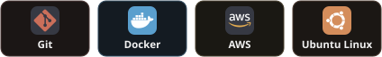

<table align="center" width="100%" role="presentation">
  <tr>
    <td width="72%" align="center" valign="middle">
      <h1>David Gutiérrez</h1>
      <h3>Ingeniero de Sistemas · Data Engineer</h3>
      

        <code>Data Engineering</code> ·
        <code>Software Development</code> ·
        <code>QA Automation</code> ·
        <code>Cybersecurity</code>
      

      

        Trabajo en ingeniería de datos, construyendo y dando soporte a procesos de ingesta, transformación, calidad y trazabilidad. Mi experiencia en desarrollo web y QA me permite abordar el ciclo completo del software con una visión integral.
      

      

        
        
      

    </td>
    <td width="28%" align="center" valign="middle">
      
    </td>
  </tr>
</table>

---

## Actualmente

<table align="center">
  <thead>
    <tr>
      <th scope="col" align="left">Experiencia</th>
      <th scope="col" align="left">Formación</th>
    </tr>
  </thead>
  <tbody>
    <tr>
      <td><strong>Data Engineer</strong> en <a href="https://www.inetum.com/global/en/locations.html">Inetum</a></td>
      <td><strong>Ingeniería de Sistemas</strong> en <a href="https://www.uniminuto.edu/bogota">UNIMINUTO Bogotá</a></td>
    </tr>
    <tr>
      <td>Pipelines, SQL, Data Functions y calidad de datos</td>
      <td><strong>Especialización en Ciberseguridad</strong> en curso</td>
    </tr>
  </tbody>
</table>

## Stack técnico

### Datos y analítica

  

  

### Desarrollo de software

  

  

APIs REST · Arquitectura backend · Aplicaciones web

### QA y automatización

  

  

Pruebas funcionales y de regresión · Validación de APIs · Seguimiento de incidencias

### Nube y herramientas

  

  

## Certificaciones y formación continua

  

La gráfica agrupa los cursos y credenciales mencionados en mi CV, ordenados de menor a mayor volumen de formación.

- **Cloud, seguridad y DevOps.** AWS Academy Cloud Security Foundations, Ethical Hacker de Cisco, fundamentos de Docker y ciberseguridad.
- **Datos e inteligencia artificial.** Data Analytics Essentials, Python para ciencia de datos, fundamentos de AI para Data y Machine Learning y observabilidad con LangSmith.
- **QA y automatización.** Cypress, Playwright, Puppeteer, React Testing Library, pruebas de usabilidad y metodología NACAR.
- **Arquitectura y backend.** Arquitectura de software, escalabilidad, Node.js, APIs REST, autenticación con Passport.js y JWT.

## Repositorios y proyectos

<table align="center">
  <tr>
    <td width="50%" align="center">
      <strong>Repositorios destacados</strong>
        
      <code>Coming soon...</code>
        
    </td>
    <td width="50%" align="center">
      <strong>Proyectos personales</strong>
        
      <code>Coming soon...</code>
        
    </td>
  </tr>
</table>

  More projects are coming soon...

